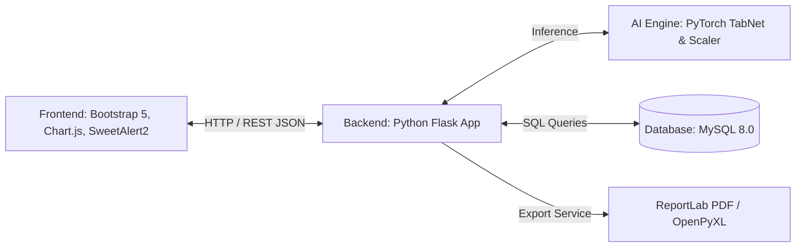

# 🍼 GiziLens — Sistem Prediksi & Pemantauan Status Gizi Balita Berbasis Web

[](https://www.python.org/)
[](https://palletsprojects.com/p/flask/)
[](https://pytorch.org/)
[](https://www.mysql.com/)
[](https://getbootstrap.com/)
[](https://www.docker.com/)

**GiziLens** adalah sistem informasi dan aplikasi cerdas berbasis web yang dirancang untuk memprediksi, mendeteksi secara dini risiko stunting, serta memantau status gizi anak balita secara komprehensif. Sistem ini mengintegrasikan teknologi *Deep Learning* mutakhir (**TabNet**) dengan standar antropometri pertumbuhan anak dari Organisasi Kesehatan Dunia (**WHO**) dan Kementerian Kesehatan RI.

---

## 📌 Daftar Isi
1. [Ikhtisar Sistem](#-ikhtisar-sistem)
2. [Spesifikasi Model & Kecerdasan Buatan (AI/ML)](#-spesifikasi-model--kecerdasan-buatan-aiml)
3. [Arsitektur & Teknologi yang Digunakan](#-arsitektur--teknologi-yang-digunakan)
4. [Daftar Library & Dependensi](#-daftar-library--dependensi)
5. [Fitur-Fitur Unggulan Sistem](#-fitur-fitur-unggulan-sistem)
6. [Batasan-Batasan yang Ditetapkan di Sistem](#-batasan-batasan-yang-ditetapkan-di-sistem)
7. [Struktur Database & Relasi Data](#-struktur-database--relasi-data)
8. [Struktur Folder & File Proyek](#-struktur-folder--file-proyek)
9. [Panduan Instalasi & Menjalankan Sistem](#-panduan-instalasi--menjalankan-sistem)
   - [Opsi A: Menjalankan Secara Lokal (Python & MySQL)](#opsi-a-menjalankan-secara-lokal-python--mysql)
   - [Opsi B: Menjalankan Menggunakan Docker & Docker Compose](#opsi-b-menjalankan-menggunakan-docker--docker-compose)
10. [Akun Pengguna Default (Pengujian)](#-akun-pengguna-default-pengujian)
11. [Informasi Pengembang](#-informasi-pengembang)

---

## 💡 Ikhtisar Sistem

Masalah stunting dan malnutrisi pada balita memerlukan pemantauan berkala dan penanganan cepat. GiziLens hadir untuk membantu tenaga medis, petugas gizi puskesmas/posyandu, serta pemangku kepentingan kesehatan dalam:
- Mengidentifikasi status gizi balita secara instan berdasarkan 3 indikator antropometri standar WHO:
  1. **BB/U (Berat Badan menurut Umur)**: Mengidentifikasi *Underfed*, *Normal*, *Malnutrition*, atau *Overnutrition*.
  2. **TB/U (Tinggi Badan menurut Umur)**: Mendeteksi apakah anak mengalami *Stunted* atau *Not Stunted*.
  3. **BB/TB (Berat Badan menurut Tinggi Badan)**: Mendeteksi status kurus (*Thin* / *Very Thin*), *Normal*, hingga *Obese*.
- Memvisualisasikan riwayat pertumbuhan anak dalam kurva standar WHO (-3SD s/d +3SD).
- Memfasilitasi pemeriksaan berkala dalam jumlah besar (*batch input*) dari survei posyandu.
- Mencetak rekap riwayat dan dokumen pemeriksaan resmi langsung ke format **PDF** dan **Excel**.

---

## 🧠 Spesifikasi Model & Kecerdasan Buatan (AI/ML)

Sistem GiziLens menggunakan model klasifikasi tingkat lanjut berbasis arsitektur **TabNet** (*Attentive Interpretable Tabular Learning*) yang dioptimalkan khusus untuk data tabular antropometri balita.

| Komponen | Spesifikasi / Keterangan |
| :--- | :--- |
| **Arsitektur Model** | **TabNet** (*Sparse Attention Mechanism* untuk data tabular) |
| **Framework Deep Learning** | `PyTorch` & `pytorch-tabnet` |
| **Hyperparameter Optimization** | **Optuna** (Metode *Tree-structured Parzen Estimator* / TPESampler, 30 Trials) |
| **Data Preprocessing** | `scikit-learn` `StandardScaler` (Standardisasi fitur: mean=0, variance=1) |
| **Dataset Pelatihan** | Data status gizi balita Kabupaten Jeneponto (2021–2024), **>42.000 riwayat pemeriksaan** |
| **Fitur Input Model** | 1. Jenis Kelamin (`Gender`: 0=Perempuan, 1=Laki-laki)<br>2. Umur (`Age`: Bulan)<br>3. Berat Badan (`Weight`: kg)<br>4. Tinggi Badan (`Height`: cm) |
| **Output Model** | 3 Klasifikasi Multi-output (Model BB/U, TB/U, dan BB/TB) |
| **Mekanisme Cadangan (Fallback)** | *Rule-based engine* standar Z-Score WHO jika file model tidak tersedia |

### 📊 Performa Evaluasi Model (Data Testing)

| Indikator | Model Target | Akurasi Uji | Presisi | Recall | F1-Score |
| :--- | :--- | :---: | :---: | :---: | :---: |
| **BB/U** | *Weight for Age* (4 Kelas) | **95.31%** | 95.08% | 95.31% | **95.19%** |
| **TB/U** | *Height for Age* (2 Kelas - Deteksi Stunting) | **94.04%** | 93.91% | 94.04% | **93.97%** |
| **BB/TB** | *Weight for Height* (4 Kelas) | **95.72%** | 95.61% | 95.72% | **95.66%** |

---

## 💻 Arsitektur & Teknologi yang Digunakan

GiziLens dibangun dengan arsitektur **Monolith Modern (MVC Pattern)** yang memisahkan antara *presentation layer*, *application logic*, dan *data layer*:



### 1. Backend (Server-Side)
- **Bahasa**: Python 3.8+
- **Web Framework**: **Flask 3.0.0** (Microframework berbasis WSGI)
- **Web Server Gateway**: Werkzeug 3.0.1
- **Manajemen Sesi & Enkripsi**: Flask Session terproteksi dengan enkripsi password menggunakan **Bcrypt** (salt round 12).
- **Environment Management**: `python-dotenv` untuk memuat variabel lingkungan (`.env` / `.env.local`).

### 2. Frontend (Client-Side & UI/UX)
- **Struktur & Tampilan**: HTML5 Semantik & CSS3 Kustom.
- **Framework Desain**: **Bootstrap 5.3.2** (Grid responsive & komponen dinamis).
- **Icon Pack**: **Bootstrap Icons 1.11.3**.
- **Tipografi**: Google Fonts (*Nunito* untuk keterbacaan teks dan *Fraunces* untuk heading).
- **Gaya Desain**: Perpaduan estetika *Neo-Brutalism* modern dengan palet warna lembut ramah anak (*Soft Pastel & Warm Accent*).
- **Visualisasi Grafik**: **Chart.js 4.4.0** (Plot kurva pertumbuhan balita terhadap standar deviasi WHO -3SD hingga +3SD).
- **Interaksi & Dialog**: **SweetAlert2 v11** (Popup modal konfirmasi, pesan kesalahan, dan animasi interaktif).
- **Komponen Kustom**: Searchable Dropdown dinamis satu kolom dengan debounce pencarian untuk memilih balita dengan cepat.

### 3. Database & Penyimpanan
- **RDBMS**: **MySQL 8.0** dengan engine `InnoDB` dan charset `utf8mb4_unicode_ci`.
- **Database Connector**: `Flask-MySQLdb 2.0.0` & `mysql-connector-python`.
- **Relational Integrity**: Foreign Key berelasi dengan `ON DELETE CASCADE` dan `ON DELETE SET NULL` serta indeks teroptimasi.

### 4. Pelaporan & Pertukaran Data (Export/Import)
- **Dokumen PDF**: **ReportLab 4.1.0** untuk menghasilkan lembar laporan medis pemeriksaan balita yang rapi, lengkap dengan tabel, logo, styling warna, serta metadata.
- **Dokumen Spreadsheet**: **OpenPyXL 3.1.2** dan **XLRD 2.0.1** untuk mengekspor rekapitulasi data pemeriksaan ke format `.xlsx` serta membaca file input pemeriksaan massal.

### 5. DevOps & Containerization
- **Container**: **Docker** & **Docker Compose**.
- **Multi-Service Compose**: Service Flask App, MySQL 8.0, dan phpMyAdmin untuk mempermudah manajemen database melalui browser.
- **Automated Startup Scripts**: `docker-setup.ps1` (Windows PowerShell) dan `docker-setup.sh` (Linux/Bash).

---

## 📦 Daftar Library & Dependensi

Seluruh paket Python tertera pada `requirements.txt`:

| Library | Versi | Fungsi / Kegunaan |
| :--- | :--- | :--- |
| `Flask` | `3.0.0` | Kerangka kerja web utama routing dan request handling |
| `Flask-MySQLdb` | `2.0.0` | Abstraksi koneksi pool dan eksekusi query MySQL di Flask |
| `python-dotenv` | `1.0.0` | Membaca variabel environment dari file `.env` |
| `bcrypt` | `4.1.2` | Hashing aman untuk enkripsi kata sandi pengguna |
| `numpy` | `1.26.4` | Operasi numerik dan manipulasi array matriks fitur |
| `pandas` | `2.2.0` | Analisis, manipulasi data tabular, dan pembacaan CSV/Excel |
| `openpyxl` | `3.1.2` | Engine manipulasi file Microsoft Excel (`.xlsx`) |
| `xlrd` | `2.0.1` | Engine pembaca format Microsoft Excel lawas (`.xls`) |
| `reportlab` | `4.1.0` | Engine pembuatan file laporan PDF resmi secara terprogram |
| `torch` | `2.1.2` | Engine komputasi tensor dan deep learning (PyTorch) |
| `pytorch-tabnet` | `4.1.0` | Implementasi model TabNet untuk klasifikasi data tabular |
| `scikit-learn` | `1.4.0` | Evaluasi metrik dan pemulihan objek scaler (`StandardScaler`) |
| `joblib` | `1.3.2` | Serialisasi dan deserialisasi objek model/scaler Python |
| `Werkzeug` | `3.0.1` | Utilitas WSGI, penanganan berkas unggahan, dan keamanan |

---

## ⭐ Fitur-Fitur Unggulan Sistem

1. **Autentikasi & Manajemen Pengguna (Petugas Gizi)**:
   - Login sesi terproteksi dengan password ber-hash Bcrypt.
   - Hak akses multi-petugas posyandu/puskesmas.
2. **Dashboard Pemantauan & Statistik**:
   - Ringkasan total balita, total pemeriksaan, rasio stunting, serta status gizi abnormal.
   - Grafik interaktif status gizi balita terkini.
3. **Pemeriksaan Status Gizi Individu**:
   - Form input ramah pengguna: kalkulasi umur otomatis dari tanggal lahir.
   - Prediksi status gizi instan (BB/U, TB/U, dan BB/TB) dalam hitungan milidetik.
   - Interpretasi hasil klinis dan saran tindakan gizi otomatis.
4. **Pemeriksaan Batch (Data Massal)**:
   - Upload file CSV atau Excel yang berisi ratusan/ribuan data pengukuran posyandu sekaligus.
   - Validasi struktur kolom otomatis dan pelaporan baris data bermasalah.
5. **Grafik Pertumbuhan Standar WHO (Chart.js)**:
   - Visualisasi lintasan tumbuh kembang anak terhadap pita standar deviasi WHO (-3SD, -2SD, Median, +2SD, +3SD).
   - Fitur pencarian balita interaktif (*Searchable Dropdown*).
6. **Riwayat Pemeriksaan & Rekap Medis**:
   - Tabel riwayat dengan pagination, pencarian nama, NIK, dan filter indikator gizi.
7. **Export Laporan (PDF & Excel)**:
   - Download lembar pemeriksaan tunggal atau rekapitulasi menyeluruh ke format PDF siap cetak.
   - Export seluruh data ke Excel (`.xlsx`) untuk analisis lanjutan oleh dinas kesehatan.
8. **Transparansi & Evaluasi Model AI (Model Information Page)**:
   - Menampilkan metrik performa model (*Accuracy, Precision, Recall, F1-Score*).
   - Diagram *Feature Importance* (faktor penentu status gizi) dan ringkasan *Confusion Matrix*.

---

## ⚠️ Batasan-Batasan yang Ditetapkan di Sistem

Untuk menjaga akurasi klinis, integritas data, performa server, dan keamanan pengguna, GiziLens menerapkan sejumlah batasan sistem yang ketat:

### 1. Batasan Rentang Antropometri & Validasi Data
- **Rentang Usia Subjek**: Sistem khusus ditujukan bagi anak usia balita, yaitu **0 hingga 60 bulan (maksimal 5 tahun)**. Tanggal lahir balita pada form pendaftaran dibatasi minimal `hari ini - 5 tahun` sampai dengan `hari ini`.
- **Rentang Berat Badan (BB)**: Dibatasi dalam rentang wajar balita, yaitu **2,0 kg hingga 30,0 kg**. Nilai di bawah 2 kg atau di atas 30 kg akan ditolak oleh sistem untuk mencegah anomali atau *human error* saat pengukuran.
- **Rentang Tinggi/Panjang Badan (TB)**: Dibatasi dalam rentang wajar balita, yaitu **35,0 cm hingga 130,0 cm**. Nilai di luar batas ini akan memicu pesan kesalahan validasi.
- **Validasi Silang Logika Klinis (Inkonsistensi Fisik)**: Sistem memiliki aturan pendeteksi kombinasi hasil yang bertentangan secara biologis (misalnya: status *Very Thin* / sangat kurus namun bersamaan dengan *Overnutrition* / kelebihan gizi berat). Jika terjadi, sistem menandainya sebagai *indikator bertentangan* akibat kesalahan pengukuran di lapangan.

### 2. Batasan Berkas & Pemrosesan Data Massal (Batch)
- **Format Berkas yang Diizinkan**: Hanya menerima berkas spreadsheet berekstensi **`.csv`**, **`.xlsx`**, dan **`.xls`**.
- **Kapasitas Unggahan Maksimum**: Dibatasi maksimal **50 MB** per unggahan berkas (`MAX_CONTENT_LENGTH = 50MB`).
- **Kelengkapan Atribut Kolom**: Berkas batch wajib memuat kolom parameter antropometri dasar: `jenis_kelamin` (L/P), `umur_bulan`, `berat_badan`, dan `tinggi_badan`. Baris data dengan nilai kosong, format teks salah, atau nilai di luar batas toleransi akan dilewati dan dilaporkan dalam log pemeriksaan.
- **Batas Tampilan Ekspor PDF**: Demi efisiensi memori render server, ekspor rekap PDF dibatasi hingga maksimal **500 riwayat pemeriksaan per dokumen**. Untuk data yang lebih besar, pengguna disarankan menggunakan ekspor Excel (`.xlsx`).

### 3. Batasan Hak Akses & Peran Pengguna (RBAC)
- **Petugas Gizi (Pengguna Standar)**: Diberikan wewenang operasional untuk registrasi balita, pemeriksaan individu, unggah data batch, melihat kurva pertumbuhan, melihat riwayat, dan mengunduh laporan PDF/Excel.
- **Admin Sistem (`admin` / `kepala kesehatan`)**: Merupakan satu-satunya peran yang berhak mengelola akun petugas (`/petugas`), seperti menambah petugas baru, memperbarui jabatan/puskesmas, atau menghapus akun.

### 4. Batasan Ruang Lingkup Machine Learning (AI)
- **Representasi Dataset Pelatihan**: Model TabNet dilatih menggunakan data status gizi balita Kabupaten Jeneponto periode 2021–2024. Karakteristik model sangat optimal untuk profil pertumbuhan balita Indonesia.
- **Variabel Prediktor Terbatas**: Model hanya memanfaatkan 4 fitur primer (*Gender, Umur, Berat Badan, Tinggi Badan*). Sistem **belum memperhitungkan** parameter tambahan seperti Lingkar Kepala (LiKA), Lingkar Lengan Atas (LiLA), riwayat kelahiran prematur/BBLR, status imunisasi, maupun riwayat morbiditas anak.
- **Mekanisme Cadangan (Fallback)**: Apabila file model AI TabNet (`.zip`) tidak tersedia atau gagal dimuat, sistem secara otomatis mengalihkan proses prediksi ke kalkulasi Z-score standar WHO, namun informasi *confidence probability* model tidak akan ditampilkan.

### 5. Batasan Klinis & Disclaimer Medis
> [!IMPORTANT]
> **Sistem Pendukung Keputusan (Bukan Vonis Medis)**:
> GiziLens dirancang murni sebagai *Clinical Decision Support System* (CDSS) dan instrumen penapisan dini (*screening tool*). Hasil prediksi dan saran yang dikeluarkan sistem **bukan merupakan diagnosis medis final atau vonis klinis mutlak**. Setiap penetapan intervensi medis, terapi gizi klinis, maupun rujukan wajib dikonfirmasikan langsung kepada dokter spesialis anak, dokter puskesmas, atau ahli gizi teregistrasi.

---

## 🗄️ Struktur Database & Relasi Data

Database sistem bernama `gizi_balita` yang terdiri dari 4 tabel utama:

```
[petugas] ──< (1:N) >── [pemeriksaan] ──< (1:1) >── [hasil_klasifikasi]
                              │
[balita]  ──< (1:N) >─────────┘
```

1. **`petugas`**: Menyimpan kredensial akun, nama lengkap, username, hash password, jabatan, dan instansi puskesmas.
2. **`balita`**: Menyimpan data identitas anak (Nama, NIK, Jenis Kelamin, Tanggal Lahir, Nama Ibu, Alamat).
3. **`pemeriksaan`**: Menyimpan catatan kunjungan (Tanggal periksa, Umur dalam bulan, Berat badan, Tinggi badan, Catatan klinis).
4. **`hasil_klasifikasi`**: Menyimpan label dan kode hasil prediksi model TabNet (`bbu_label`, `tbu_label`, `bbtb_label`, metadata model, timestamp).

---

## 📂 Struktur Folder & File Proyek

```text
GiziLens/
│
├── app.py                        # Entry point utama aplikasi Flask (routing & controllers)
├── requirements.txt              # Daftar dependensi library Python
├── README.md                     # Dokumentasi komprehensif sistem
├── .gitignore                    # Berkas yang diabaikan oleh Git
├── .env                          # Konfigurasi environment & kredensial database
├── .env.example                  # Template konfigurasi environment
├── .dockerignore                 # Berkas yang diabaikan saat proses build container
├── Dockerfile                    # Spesifikasi container image Python Flask
├── docker-compose.yml            # Konfigurasi orkestrasi service (App + MySQL + phpMyAdmin)
├── docker-entrypoint.sh          # Script inisialisasi container saat startup
├── docker-setup.sh               # Otomasi instalasi Docker (Linux / macOS)
├── docker-setup.ps1              # Otomasi instalasi Docker (Windows PowerShell)
│
├── database/                     # Skrip skema database
│   └── database.sql              # Skema tabel MySQL, indeks, dan data awal/dummy
│
├── docs/                         # Dokumentasi teknis & panduan troubleshooting
│   ├── DOCKER_SETUP.md           # Panduan lengkap setup menggunakan Docker
│   ├── DOCKER_COMMANDS.md        # Perintah-perintah penting Docker
│   ├── SETUP_INFORMASI_MODEL.md  # Konfigurasi halaman metrik model
│   └── TROUBLESHOOTING_DATABASE.md# Panduan penanganan kendala koneksi MySQL
│
├── models/                       # File model Machine Learning terlatih & skaler
│   ├── model_evaluation.json     # Metrik evaluasi akurasi, presisi, recall, F1, & importance
│   ├── save_scaler.py            # Skrip pembantu ekspor StandardScaler
│   ├── standard_scaler.joblib    # Objek scaler serialisasi Scikit-Learn
│   ├── tabnet_height_for_age.zip # Model TabNet terlatih untuk TB/U (Stunting)
│   ├── tabnet_weight_for_age.zip # Model TabNet terlatih untuk BB/U
│   └── tabnet_weight_for_height.zip # Model TabNet terlatih untuk BB/TB
│
├── notebooks/                    # Eksperimen riset dan training model
│   └── hasil_modeling_tabnet.ipynb # Jupyter Notebook pelatihan TabNet & Optuna
│
├── scripts/                      # Utilitas script pengujian backend
│   ├── setup_db.py               # Inisialisasi cepat database via Python
│   ├── test_db_connection.py     # Verifikasi konektivitas database
│   ├── test_model_api.py         # Pengujian inferensi model AI di terminal
│   └── verify_model_setup.py     # Verifikasi konsistensi parameter model
│
├── static/                       # Aset statis frontend
│   ├── contoh_data_batch.csv     # File template contoh untuk input massal
│   ├── grafik.js                 # Skrip logika rendering Chart.js pertumbuhan balita
│   ├── model_info.js             # Skrip interaksi grafik metrik pada halaman model info
│   ├── images/                   # Asset gambar, ikon, dan logo
│   └── uploads/                  # Direktori penyimpanan file sementara
│
├── templates/                    # Antarmuka web berbasis Jinja2 (HTML Template)
│   ├── base.html                 # Layout induk (Navbar, Sidebar, Footer, Asset CDN)
│   ├── dashboard.html            # Dashboard ringkasan metrik statistik
│   ├── login.html                # Form autentikasi petugas
│   ├── pemeriksaan.html          # Form input pemeriksaan balita individu
│   ├── batch.html                # Halaman unggah data pemeriksaan massal
│   ├── hasil.html                # Halaman detail hasil prediksi & rekomendasi tindakan
│   ├── grafik_pertumbuhan.html   # Halaman analisis kurva pertumbuhan balita (WHO Standard)
│   ├── riwayat.html              # Halaman tabel riwayat pemeriksaan & export
│   ├── petugas.html              # Halaman manajemen data petugas
│   └── informasi_model.html      # Halaman profil arsitektur & akurasi model TabNet
│
└── utils/                        # Modul pembantu (Helpers)
    ├── __init__.py
    └── predictor.py              # Loader model TabNet, pra-pemrosesan, & fallback WHO
```

---

## ⚙️ Panduan Instalasi & Menjalankan Sistem

Anda dapat menjalankan GiziLens dengan dua cara: **Secara Lokal (Python Virtual Environment)** atau **Menggunakan Docker**.

### Opsi A: Menjalankan Secara Lokal (Python & MySQL)

#### 1. Prasyarat Sistem
- **Python 3.8 s/d 3.11** terpasang (`python --version`).
- **MySQL Server 8.0+** aktif dan berjalan.
- **Git** (opsional).

#### 2. Konfigurasi Database
1. Buka MySQL client (CLI / phpMyAdmin / DBeaver).
2. Buat database baru bernama `gizi_balita`:
   ```sql
   CREATE DATABASE gizi_balita CHARACTER SET utf8mb4 COLLATE utf8mb4_unicode_ci;
   ```
3. Import file `database/database.sql` ke dalam database `gizi_balita`.

#### 3. Konfigurasi Lingkungan (`.env`)
Salin file `.env.example` menjadi `.env`:
```bash
cp .env.example .env
```
Sesuaikan kredensial MySQL Anda pada file `.env`:
```ini
SECRET_KEY=gizi-balita-secret-key-2024
MYSQL_HOST=localhost
MYSQL_PORT=3306
MYSQL_USER=root
MYSQL_PASSWORD=password_mysql_anda
MYSQL_DB=gizi_balita
```

#### 4. Instalasi Virtual Environment & Dependensi
Buka terminal di root direktori proyek:
```bash
# Membuat virtual environment
python -m venv venv

# Mengaktifkan virtual environment
# Pada Windows:
.\venv\Scripts\activate
# Pada macOS / Linux:
source venv/bin/activate

# Instalasi seluruh library
pip install -r requirements.txt
```

#### 5. Menjalankan Aplikasi
```bash
python app.py
```
Aplikasi akan aktif dan dapat diakses melalui browser pada alamat:
👉 **http://localhost:5000** atau **http://127.0.0.1:5000**

---

### Opsi B: Menjalankan Menggunakan Docker & Docker Compose

Metode ini paling praktis karena seluruh dependensi Python dan MySQL otomatis terkonfigurasi di dalam kontainer.

#### 1. Prasyarat
- **Docker Desktop** sudah terpasang dan berstatus *Running*.

#### 2. Jalankan Script Otomatis

**Pada Windows (PowerShell):**
```powershell
.\docker-setup.ps1
```

**Pada Linux / macOS (Terminal):**
```bash
chmod +x docker-setup.sh
./docker-setup.sh
```

*Atau jalankan secara manual menggunakan Docker Compose:*
```bash
docker-compose up -d --build
```

#### 3. Akses Layanan Kontainer
- 🌐 **Aplikasi Web GiziLens**: [http://localhost:5000](http://localhost:5000)
- 🗄️ **phpMyAdmin (Kelola Database)**: [http://localhost:8080](http://localhost:8080) *(User: `root`, Password: `root`)*

---

## 🔐 Akun Pengguna Default (Pengujian)

Database telah dilengkapi dengan akun bawaan untuk mempermudah pengujian:

| Username | Password | Jabatan | Akses Instansi |
| :--- | :--- | :--- | :--- |
| `admin` | `admin123` | Admin Sistem | Puskesmas Jeneponto |
| `petugas1` | `admin123` | Petugas Gizi | Puskesmas Jeneponto |

---

## 👩‍💻 Informasi Pengembang

- **Peneliti / Pengembang**: Sherlly Briliant Saputri
- **Institusi**: Program Studi Informatika, Universitas Teknologi Yogyakarta
- **Kategori**: Proyek Profesional / Tugas Akhir Semester 7
- **Fokus Riset**: Penerapan Arsitektur Deep Learning TabNet untuk Deteksi Multi-Output Status Gizi dan Pencegahan Stunting Anak di Indonesia
